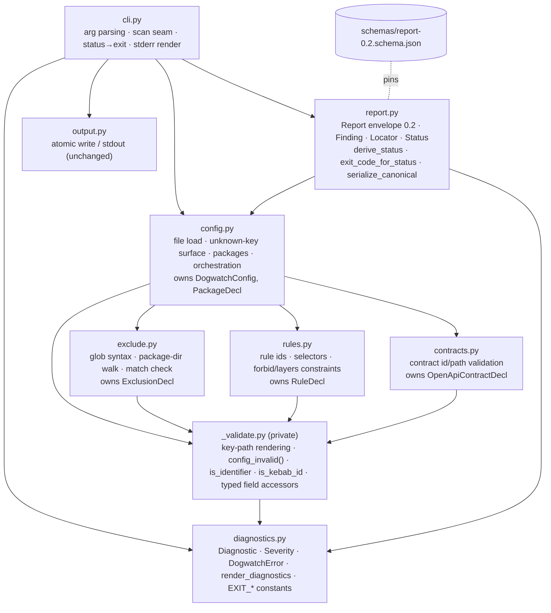

# Architecture — CD-6: Validated Dogwatch Configuration and Common Report Contracts

## 1. Summary

CD-6 adds two contracts to the CD-5 `dogwatch` scanner: the validated `dogwatch.toml` configuration model (frozen spec FR-001–FR-009, AC-1/AC-2) and the common report model every adapter uses (FR-010–FR-015, AC-3). The work also adds a pure status→exit-code mapping that keeps the four AC-4 failure modes distinguishable (FR-016–FR-018), and one new golden fixture (FR-019). The approach changes the existing single-process, stdlib-only CLI in place rather than building anything new around it:

- `config.py` remains the validation orchestrator. It hands each new declaration domain to a focused module: `exclude.py`, `rules.py` and `contracts.py`.
- These modules share one small private module of validation helpers, `_validate.py`.
- `report.py` holds the 0.2 envelope, the `Finding`/`Locator` model, status derivation and the exit mapping.
- `diagnostics.py` holds the single four-field `Diagnostic`.
- `cli.py` gets a scan seam that returns nothing in this ticket (A-1). This makes the fail and inconclusive paths real code that tests can reach.

The pipeline is fully synchronous: load → validate → scan seam → derive status → serialize → write → render → exit. A config failure raises before any report exists (A-7). Every scan outcome is data inside the report, and the exit code is derived from that data alone (FR-011, FR-016). This design follows the planner's implementation plan (`artifacts/planning/implementation_plan.md` §5–§7), which this document takes as given. It refines that plan in two places, both called out below: a shared-helpers module, and a canonical order for findings and diagnostics.

## 2. Technology Choices

| Concern | Choice | Binding |
|---|---|---|
| Language / runtime | Python ≥ 3.11 (`scanner/pyproject.toml` `requires-python`). **Stdlib only, with zero runtime dependencies**, enforced by `tests/test_isolation.py`. | Spec Overview (CD-5 delta), constitution: scanner isolation |
| Config parsing | `tomllib` (stdlib). Its `TOMLDecodeError` line number feeds the FR-001 diagnostic, as `config.py:_error_line` already does. | FR-001, A-12 |
| Exclusion glob matching | A hand-written matcher that works on path segments: a segment that is exactly `**` matches zero or more segments, and any other `*` matches only within its own segment. Directories are walked with `os.scandir` and `DirEntry.is_file(follow_symlinks=False)`. **Rejected:** `fnmatch` (its `*` crosses `/`), `PurePath.full_match` (3.13+ only), and `pathspec`/`wcmatch` (would break the isolation test). | FR-004, Edge Cases "Exclusions"/"Trust boundary", constitution: isolation |
| Report serialization | The existing `report.serialize_canonical` is unchanged: `sort_keys`, `indent=2`, `ensure_ascii=False`, `(",", ": ")` separators, trailing newline. Writes stay atomic via `output.write_report`. | FR-014, A-12 |
| Report shape pin | JSON Schema Draft 2020-12 at `scanner/schemas/report-0.2.schema.json`, `$id: urn:dogwatch:schema:report:0.2`. `jsonschema` remains a **dev-only** dependency used by the tests. | FR-015, A-8 |
| Type modelling | Frozen `@dataclass`es plus `typing.Literal` for the closed vocabularies (`Severity`, `Status`, rule `kind`), matching the existing `PackageDecl` and `Diagnostic` idiom. Everything passes `mypy --strict`. | Constitution: stable entity names; SC-004 |
| Storage, message bus, network | **None.** The scanner reads one file and the package-directory listing, and writes one file or stdout. | A-1, Edge Cases "Trust boundary" |

No new dependencies are introduced.

## 3. Component Decomposition

Imports flow in one direction only: `diagnostics` ← `_validate` ← {`exclude`, `rules`, `contracts`} ← `config` ← `report` ← `cli`. There are no cycles.

| Component | Responsibility | Owns | Boundary |
|---|---|---|---|
| `diagnostics.py` | The single `Diagnostic` entity (FR-013); the `Severity` literal; `DogwatchError`, which carries at least one pre-scan diagnostic; `render_diagnostics(seq) -> str` (`dogwatch:<id>: <message>` per line, FR-018); the exit constants `EXIT_OK=0`, `EXIT_GATE_FAILED=1` (now emitted) and `EXIT_ERROR=2` (FR-016) | Diagnostic shape, stderr format, exit constants | Imports nothing from `dogwatch`. `Diagnostic.id` widens from the CD-5 `Literal` to `str`, because adapters supply their own ids (FR-013). The scanner's own ids become named constants. |
| `_validate.py` *(refinement over the plan's §4)* | Shared helpers for config validation: render a TOML key path (`python.rules[1].targets[0]`); `config_invalid(message) -> DogwatchError` with `source="dogwatch"`, `severity="error"`; `is_identifier` (`isidentifier() and not iskeyword`, plan D-2); `is_kebab_id` (`^[a-z][a-z0-9]*(-[a-z0-9]+)*$`, ≤ 64 characters); typed accessors (`require_str`, `optional_str_list`, …) that phrase errors in the established "`<path> is required`" / "`<path> must be a string`" style | No entities | Needed because `config.py` imports the three domain modules, so they cannot import helpers back from it without an import cycle. It also lets `contracts.py` reuse the rule-id grammar without depending on `rules.py` (FR-008 says "same ID rules as FR-005"). |
| `config.py` | The public entry point `load_policy(config_arg) -> DogwatchConfig`. It reads the file and parses TOML (FR-001), finds unknown keys across the table-level surface (FR-009), validates packages (FR-003) and checks package filesystem structure. It then delegates `exclude`, `rules` and `contracts`, and runs the validation stages (§5.1). | `DogwatchConfig` (the rename of `PolicyConfig` that Key Entities requires), `PackageDecl` | The only module that builds a `DogwatchConfig`. Any failure raises `DogwatchError`. |
| `exclude.py` | `parse_exclusions(value) -> tuple[ExclusionDecl, ...]` checks glob syntax at the document stage. `check_matches(config_dir, packages, exclusions) -> None` walks the package directories at the filesystem stage and collects one `exclude-unmatched` per unmatched pattern (FR-004). | `ExclusionDecl`, the glob matcher | Lists directory entries only, under `<config_dir>/<root>/<name>/`. It never opens a file there and never follows symlinks (trust boundary). The walk runs only when `exclude` is non-empty (plan D-13). |
| `rules.py` | `parse_rules(value) -> tuple[RuleDecl, ...]` checks `kind`, then the key set for that kind (FR-009), then required fields and types, then id uniqueness and grammar, selector syntax and the descendant/prefix constraints (FR-005–FR-007). | `RuleDecl` | Syntax only: whether a selector matches any module is never checked (A-14). Does no filesystem access. |
| `contracts.py` | `parse_contracts(value) -> tuple[OpenApiContractDecl, ...]` checks id grammar and uniqueness, path syntax (relative, `/`-separated, no `.`/`..`/empty segments, no backslash, `.yaml`/`.yml`/`.json`) and path uniqueness (FR-008, plan D-3). | `OpenApiContractDecl` | Never checks that the file exists (FR-008). Does no filesystem access. |
| `report.py` | `Finding`, `Locator`, `Status`; `derive_status` (FR-011); `exit_code_for_status` (FR-016); `build_report(cfg, version, findings=(), diagnostics=())`, which sorts findings and diagnostics into canonical order (§5.3) and converts each to JSON with explicit per-entity functions; `serialize_canonical` (unchanged) | Report envelope, status semantics, JSON projection | Pure functions only, with no I/O. |
| `cli.py` | Parses arguments; runs `load_policy`; keeps the same-file guard; `scan(cfg) -> tuple[tuple[Finding, ...], tuple[Diagnostic, ...]]` returns `((), ())` in CD-6 (A-1, plan D-5); builds, serializes and writes the report; renders scan-time diagnostics to stderr (FR-018); returns `exit_code_for_status(status)` | Run orchestration | The engine and adapter tickets replace the body of `scan` without changing its signature. |
| `output.py` | Atomic file write or stdout, with broken-pipe handling | — | Unchanged (A-12). |
| `schemas/report-0.2.schema.json` | Pins the report shape (FR-015) | The external contract shape | Replaces `report-0.1.schema.json`, which is removed (plan D-8). |
| `fixtures/full-surface/` | The end-to-end proof that the whole AC-2 surface works (FR-019) | Static config, source tree, a static OpenAPI spec file, and a golden generated by `make regen-fixtures` | Static data only: never imported or executed. |

## 4. Data Model

Entity names are the frozen spec's Key Entities, used verbatim. All entities are frozen dataclasses.

### 4.1 Configuration entities (produced only by successful validation)

| Entity | Field | Type | Rule (spec ref) |
|---|---|---|---|
| **DogwatchConfig** | `path_arg` | `str` | As given on the CLI |
| | `raw` | `bytes` | Input to the policy digest (FR-010) |
| | `packages` | `tuple[PackageDecl, ...]` | At least 1 (FR-003, A-3) |
| | `exclusions` | `tuple[ExclusionDecl, ...]` | 0 or more (A-3) |
| | `rules` | `tuple[RuleDecl, ...]` | 0 or more (FR-005, A-3) |
| | `contracts` | `tuple[OpenApiContractDecl, ...]` | 0 or more (FR-008, A-3, US-6) |
| **PackageDecl** | `name` | `str` | A single identifier, not a keyword (FR-003, Edge Cases) |
| | `root` | `str` | A directory relative to the config's directory; `<root>/<name>` exists and is a directory; no duplicates, splits across roots or nesting (FR-003, A-9) |
| **ExclusionDecl** | `pattern` | `str` | Non-empty, relative, `/`-separated; no `.`/`..`/empty segments; only `*` is a wildcard (`?`, `[` and `\` are rejected); case-sensitive; must match at least 1 regular file under a declared package directory (FR-004, A-11) |
| **RuleDecl** | `id` | `str` | Kebab-case, ≤ 64 characters, unique across rules (FR-005) |
| | `kind` | `Literal["forbid","layers"]` | FR-005 |
| | `reason` | `str` | Non-empty (FR-005, A-10) |
| | `targets` | `tuple[str, ...]` | forbid: required and non-empty (FR-006) |
| | `sources` | `tuple[str, ...]` | forbid: optional and non-empty when present; an empty tuple means the default scope, which is all scanned packages (FR-006) |
| | `except_sources` / `except_targets` | `tuple[str, ...]` | forbid: optional and non-empty when present; each entry must be a strict descendant of some `sources` entry or `targets` entry respectively (FR-006) |
| | `layers` | `tuple[str, ...]` | layers: required, non-empty and ordered; no duplicates; no entry may be a dotted prefix of another (FR-007) |
| | `container` | `str \| None` | layers: optional; required when `exhaustive` is true, and then every layer must be a strict descendant of it (FR-007) |
| | `exhaustive` | `bool` | layers: default `False` (FR-007) |
| **OpenApiContractDecl** | `id` | `str` | Same grammar as rule ids; unique across contracts (FR-008) |
| | `path` | `str` | Relative; `.yaml`/`.yml`/`.json`; no `..`/`.`/absolute/backslash; unique; existence not checked (FR-008, A-9) |

On `RuleDecl`, the fields that belong to the other kind keep their empty defaults (an empty tuple, `None` or `False`). This is the single kind-discriminated entity that Key Entities names. A **selector** is dotted, and every segment passes `is_identifier`. "X is a strict descendant of Y" means `X != Y and X.startswith(Y + ".")`. Selectors are checked for syntax only (A-14).

### 4.2 Report entities

| Entity | Field | Type | Rule (spec ref) |
|---|---|---|---|
| **Report** (JSON envelope; every field always present) | `schema_version` | `"0.2"` | FR-010, A-8 |
| | `status` | `Status` | Derived (FR-011) |
| | `scanner` | `{name: "dogwatch", version: semver}` | Provenance (FR-010, A-4) |
| | `policy` | `{path: basename(path_arg), digest: {sha256: hex(sha256(raw))}}` | Provenance (FR-010, A-4) |
| | `findings` | `list[Finding]` | Canonical order (§5.3) |
| | `diagnostics` | `list[Diagnostic]` | Canonical order (§5.3) |
| **Finding** | `source` | `str` (non-empty) | The producing adapter's name (FR-012) |
| | `check_id` | `str` (non-empty) | The violated rule id (FR-012) |
| | `severity` | `Severity` | FR-012 |
| | `message` | `str` | Display only (FR-012) |
| | `fingerprint` | `str` (non-empty) | Derived deterministically from the rule, source and target, never from lines, message text or time. The derivation algorithm belongs to each adapter's ticket (FR-012, A-13). |
| | `waiver` | `None` | Always `null` in 0.2. The schema pins `{"type":"null"}` (FR-012, plan D-10). |
| | `locator` | `Locator` | FR-012 |
| **Locator** | `path` | `str` (non-empty) | Relative to the config file's directory (A-9) |
| | `line`, `column` | `int \| None` (≥ 1) | Only where the adapter knows them |
| | `source_module`, `target_module` | `str \| None` | The logical location of a Python finding (FR-012, plan D-11) |
| **Diagnostic** | `source` | `str` (non-empty) | `"dogwatch"` for the scanner, or the adapter's name (FR-013) |
| | `id` | `str`, kebab-case | In the reserved `dogwatch` namespace. The `dogwatch:` prefix appears only in the stderr render (FR-013, FR-018). |
| | `severity` | `Severity` | FR-013 |
| | `message` | `str` | FR-013 |
| **Severity** | — | `Literal["error","warning","info"]` | FR-012, FR-013 |
| **Status** | — | `Literal["pass","fail","inconclusive"]` | FR-011 |
| **ExitCode** | — | `EXIT_OK=0`, `EXIT_GATE_FAILED=1`, `EXIT_ERROR=2` | FR-016, A-6 |

**JSON projection:** `report.py` uses explicit converter functions rather than `dataclasses.asdict`. A `Locator`'s `None` fields are **omitted**: the schema makes `line`, `column`, `source_module` and `target_module` optional and non-null, with `additionalProperties: false`. `Finding.waiver` is **always emitted** as `null`. Key order does not matter, because serialization sorts keys (FR-014).

**Diagnostic ids known to the scanner:**
- Before the scan (stderr only, never in a report, A-7): `config-not-found`, `config-invalid`, `exclude-unmatched`.
- During the scan (in the report): `source-syntax-invalid`.

The adapter-failure class is any error-severity diagnostic whose `source` is an adapter. Adapters use their own ids for it, for example the CD-4 `openapi-tool-failed` and `openapi-tool-timeout` (FR-013, FR-017).

**Relationships:**
- One `DogwatchConfig` produces one Report per run.
- `Finding.check_id` refers to a rule id. The schema does not enforce this.
- `Diagnostic.source` names a component and never names a violated rule.

### 4.3 State transitions (run lifecycle; frozen spec "State transitions")

```mermaid
stateDiagram-v2
    [*] --> Loaded: read + UTF-8 + tomllib
    Loaded --> Validated: document stage → package-structure stage → exclusion-walk stage
    Loaded --> PreScanFailure: DogwatchError
    Validated --> PreScanFailure: DogwatchError
    Validated --> Scanned: scan(cfg) → ((), ()) in CD-6
    Scanned --> StatusDerived: derive_status
    StatusDerived --> Written: serialize_canonical + write_report
    Written --> [*]: render scan-time diags; exit 0/1/2 by status
    Written --> WriteFailure: OSError
    PreScanFailure --> [*]: stderr render, no report, exit 2
    WriteFailure --> [*]: "dogwatch: error: cannot write…", exit 2
```

**Status derivation (FR-011, pure):**
1. If any diagnostic has severity `error`, the status is `inconclusive`.
2. Otherwise, if any finding has severity `error` and `waiver is None`, the status is `fail`.
3. Otherwise, the status is `pass`.

Warnings and info never change the status. A report with both an error finding and an error diagnostic is `inconclusive`, which fails closed (Edge Cases "Report and exit").

### 4.4 Schema evolution (migration_and_schema_evolution)

The report schema moves from `0.1` to `0.2`:
- It adds `status` and `diagnostics` and gives `findings` item shapes.
- The 0.1 schema file is removed. The three test files that refer to it switch to 0.2. Git history preserves the old file (plan D-8).
- The golden for `fixtures/minimal` is regenerated only through `make regen-fixtures`. Its config does not change (FR-019, US-5).

Future fields wait for their consuming tickets, and each one bumps `schema_version`: the workflow provenance (A-4), a waiver object (FR-012), and adapter-specific locator fields (A-13). The existing `FORBIDDEN_FIELDS` guard in `test_schema.py` stays in place.

## 5. Interaction Topology

Everything is an **in-process, synchronous function call** inside one short-lived CLI process. There are no queues, no pub/sub, no network calls and no concurrency (A-1).

### 5.1 Validation staging inside `load_policy` (FR-001, FR-002, FR-009; plan D-6)

| # | Stage | Performed by | Failure semantics |
|---|---|---|---|
| 1 | File load: exists, is a regular file, readable, UTF-8, TOML | `config.py` | **Fail-fast.** Raises one `config-not-found` or `config-invalid` diagnostic, with the TOML line number for syntax errors. |
| 2a | Unknown keys at table level: top level, `[python]`, `[openapi]`, package entries, contract entries | `config.py` | **Fail-fast.** Unknown keys are collected, sorted, and the first one is reported as "`<key path>` is not supported in this version". This covers the keys of later tickets (A-2). |
| 2b | Document values, in a fixed order: `python` table type → packages → `exclude` syntax → rules → `openapi` table type → contracts | `config.py` → `exclude.parse_exclusions`, `rules.parse_rules`, `contracts.parse_contracts` | **Fail-fast.** The first violation raises a `config-invalid` diagnostic that names the key path. Rule-entry unknown keys are checked inside `parse_rules`, after `kind` has been validated, because the accepted key set depends on the kind. |
| 3 | Package filesystem structure | `config.py` | **Aggregated**, keeping the existing order and messages, then raised. |
| 4 | Exclusion matching walk (only when `exclude` is non-empty) | `exclude.check_matches` | **Aggregated**: one `exclude-unmatched` per pattern, in config order, then raised. |

When a stage fails, no later stage runs. The rule is precision, not aggregation (FR-002). Every config-time diagnostic is built as `Diagnostic(source="dogwatch", id=<config id>, severity="error", message=<message containing the key path>)` (SC-001).

### 5.2 Call edges in the run and their failure semantics

| Edge | Call | Success | Failure → semantics |
|---|---|---|---|
| `cli` → `config` | `load_policy(config_arg)` | `DogwatchConfig` | `DogwatchError` → `render_diagnostics(err.diagnostics)` to stderr, **no report**, `EXIT_ERROR` (FR-017 "malformed config", A-7) |
| `cli` (guard) | `_same_file(output, config)` | continue | `dogwatch: error: …`, exit 2, nothing written (A-12) |
| `cli` → `cli.scan` | `scan(cfg)` | `(findings, diagnostics)`; both empty in CD-6 | **Must not raise for scan problems.** An invalid source file or an adapter failure is *returned* as an error `Diagnostic` (FR-013). An unexpected exception is a bug: it is not caught or converted, and Python exits with status 1. *(See OQ-1.)* |
| `cli` → `report` | `build_report(cfg, version, findings, diagnostics)` → `serialize_canonical` | bytes | Pure; no failure path |
| `cli` → `output` | `write_report(data, output_arg)` | file replaced atomically, or bytes on stdout | `OSError` → `dogwatch: error: cannot write report to …`, exit 2, no partial file (A-12) |
| `cli` → `diagnostics` | `render_diagnostics(report_diagnostics)` to stderr | lines on stderr, in the same order as in the report; empty for every CD-6 run | Not reached when the write failed, so the write error stays the last thing on stderr (plan D-12) |
| `cli` → `report` | `exit_code_for_status(status)` | `0` pass, `1` fail, `2` inconclusive | Pure (FR-016) |

### 5.3 Canonical collection order *(refinement over the plan, binding: FR-014)*

FR-014 requires byte-identical output for identical inputs. To make that hold no matter what order adapters produce results in, `build_report` sorts before it serializes:
- **findings** by `(locator.path, line or 0, column or 0, check_id, fingerprint, source)`;
- **diagnostics** by `(source, id, message)`.

The stderr render uses the sorted diagnostics. With this in place, adapters do not each have to guarantee a deterministic emission order.

### 5.4 The four AC-4 modes as (report, exit) pairs (FR-017, SC-002)

| Mode | Where it arises | Report | Stderr | Exit |
|---|---|---|---|---|
| Policy violation | `scan` returns an error `Finding` | written, `status: "fail"` | scan-time diagnostic lines, if any | 1 |
| Malformed config | `load_policy` raises | **none** | `dogwatch:config-not-found\|config-invalid\|exclude-unmatched: …` | 2 |
| Invalid source syntax | `scan` returns `Diagnostic(source="dogwatch", id="source-syntax-invalid", severity="error")` | written, `status: "inconclusive"` | `dogwatch:source-syntax-invalid: …` | 2 |
| Adapter failure | `scan` returns `Diagnostic(source=<adapter>, id=<adapter id>, severity="error")` | written, `status: "inconclusive"` | `dogwatch:<adapter id>: …` | 2 |

Tests replace `cli.scan` (for example with `monkeypatch`) to build the policy-violation, invalid-source and adapter-failure modes through the real CLI path. Malformed config is triggered end to end (A-5). Every report produced this way is validated against the 0.2 schema (SC-005).

## 6. Cross-Cutting Concerns

| Concern | Treatment | Binding |
|---|---|---|
| **Determinism / idempotency** | Content-derived fields only: no wall-clock time, random ids, host, user or cwd in the report. Canonical serialization and canonical collection order (§5.3). Re-running on the same inputs gives the same bytes. The atomic write means a rerun never leaves a partial report. Verified by the golden harness's TZ/LC_ALL/HOME/PYTHONHASHSEED variants and leak assertions. | FR-014, SC-003, US-1 |
| **Trust boundary** | Scanned code is never imported or executed; this guarantee is absolute and unchanged. The only new filesystem access is `os.scandir` on the package directories during the exclusion walk, reading names and types only. File contents there are never opened and symlinks are not followed. `test_trust_boundary.py` and the `load_policy` trust tests in `test_config.py` change to this narrower invariant, gaining an `os.scandir` whitelist entry and a variant with exclusions. | Edge Cases "Trust boundary" |
| **Dependency isolation** | Stdlib only. All new modules import only from the stdlib or `dogwatch.*`, enforced by `test_isolation.py`. | Constitution: scanner isolation |
| **Observability** | Stderr is the only channel. Pre-scan and scan-time diagnostics use one format, `dogwatch:<id>: <message>`. Usage and write errors use `dogwatch: error: <message>`. There is no logging framework, no metrics and no SLOs: no requirement asks for them. | FR-018, A-12 |
| **Error taxonomy** | Three categories that never overlap. (1) *Pre-scan config diagnostics* go to stderr only. (2) *Scan-time diagnostics* go in the report (`source` + `id`), are also rendered to stderr, and an error makes the run inconclusive. (3) *Findings* are policy violations, and an error finding makes the run fail. Exit codes are 0/1/2, and exit 2 is never a pass. | FR-013, FR-016, FR-017, A-6 |
| **Secrets and config management** | The `dogwatch.toml` contract (§4.1) is the only configuration. It contains no secrets. Paths are anchored at the config file's directory. | FR-003–FR-009, A-9 |
| **API surface and versioning** | The external surface is the CLI (`dogwatch check --config --output`, `--version`, no new flags; P-2 is not built) plus the report JSON, versioned by `schema_version` and the schema file named for that version. | FR-010, FR-015, A-8, A-12 |
| **Auth, rate limiting, caching, background jobs, messaging, deployment, retention, backup/DR** | Not applicable. No acceptance criterion or clarification answer asks for any of them, so none are designed. | Spec Overview, A-1 |
| **Performance measurement** | The frozen spec has no performance success criterion, so the bundle's load-test rubric does not apply and none is added. The existing `test_resources.py` budget (peak child RSS ≤ 200 MB) must stay green as part of SC-004. | SC-004 |

## 7. Open Questions

None of these blocks the work. Each has a recorded default, and changing that default affects one localized point plus its tests.

1. **OQ-1: unexpected exceptions during the scan.** The frozen spec defines the inconclusive mode only for diagnostics that are *returned* (FR-013, FR-017). It does not say what happens when a component raises an unexpected exception. Python's default exit status for an uncaught exception is 1, which a CI pipeline would read as "gate failed" (a policy violation). CD-6's scan seam cannot raise, but the engine and adapter tickets will plug into it.
   - *Default here:* the scan contract is "return diagnostics, never raise for scan conditions". No catch-all is added in CD-6.
   - *Ask:* should the CLI catch-all map an unexpected exception to exit 2, either as an `inconclusive` report or with no report? Section that should answer: **FR-016 / A-6**.
2. **OQ-2: the `source` value for adapter diagnostics.** FR-013 and FR-017 say an adapter failure is a diagnostic "whose `source` is an adapter" with a distinct `source`. The CD-4 ADR (paper §"source", line 383) instead sets `source = "dogwatch"` for adapter diagnostics and `"oasdiff"` for findings.
   - *Default here:* the frozen spec wins. `"dogwatch"` is reserved for the scanner, and each adapter uses its own name as `source`; tests use `"openapi"`.
   - *Ask:* confirm the adapter naming vocabulary. Section that should answer: **FR-013 / A-13**.
3. **OQ-3: the exclusion match domain (plan D-1).** The default reads "under a declared package root" as "under `<root>/<name>/`". Section: **FR-004 / A-11**.
4. **OQ-4: keyword segments in selectors (plan D-2).** The default rejects Python keywords in selector segments as well as in package names. Section: **FR-006 / FR-007 / Edge Cases "Rules"**.
5. **OQ-5: `.` segments in contract paths (plan D-3).** The default rejects them, so that two different-looking paths cannot point to the same file. Section: **FR-008 / Edge Cases "OpenAPI contracts"**.
6. **OQ-6: the fingerprint format.** FR-012 fixes what goes into a fingerprint but not its encoding. The 0.2 schema requires only a non-empty string. Pinning a format later (for example 64-character hex) would need a schema bump. Section: **FR-012 / FR-015**.
