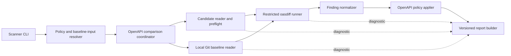

# Summary

The scanner gains a synchronous OpenAPI comparison adapter that coordinates existing policy loading and report generation with four bounded stages: resolve the explicit local Git baseline, validate and canonicalize each candidate/baseline contract, run the archive-verified oasdiff v1.39.0 binary through an argument vector, and normalize/policy-process its declared breaks into the versioned Dogwatch report. This design implements FR-001 through FR-013 while preserving the existing rule that error diagnostics make the combined report `inconclusive` and unwaived error findings make it `fail`. The CD-4 paper at `.am/reports/5b28548a-4c88-4600-b7cc-a6df1df95c7b-research-paper.md` informs the separation of Git retrieval, preflight, tool execution, and normalization; its older container, v1.33.0, and input-support decisions are superseded by the frozen specification’s FR-003 and FR-004.

# Technology Choices

| Choice | Architectural use | Basis |
|---|---|---|
| Python 3.11+ and the existing `dogwatch` scanner package | Extend the existing CLI, `DogwatchConfig`, report model, diagnostics, and deterministic JSON serializer rather than introduce a second executable. | Existing workspace patterns; FR-008 requires the standard report and FR-009 requires deterministic findings. |
| Python standard library: `subprocess`, `tempfile`, `os`, `hashlib`, `json`, and `tomllib` | Execute Git and oasdiff without a command interpreter; create restricted temporary inputs; calculate raw-byte SHA-256; retain the existing TOML policy loader. | FR-001, FR-004, FR-005, FR-010, and FR-011. |
| Local Git command-line plumbing | Resolve the supplied ref once to a commit, inspect the exact same relative path at that commit, and read only its blob bytes. No fetch, clone, checkout mutation, or baseline inference is permitted. | FR-001, FR-002, and the local-only assumption. |
| Official oasdiff v1.39.0 release binary plus pinned archive-checksum manifest | A tool descriptor selects the supported-platform archive, validates its archive digest before executable use, and identifies the fixed release used by every comparison. A missing or invalid verified tool is a diagnostic condition. | FR-004 and FR-013. |
| A version-specific oasdiff command profile | The runner receives only a fixed executable path, fixed options, and adapter-created file paths as an argv list. The profile must explicitly disable external reference loading and produce structured change records for normalization. | FR-004, FR-005, FR-008, and FR-009. Exact profile flags remain an open question because the frozen spec does not state them. |
| New versioned Dogwatch JSON Schema | Evolve the current schema rather than attaching undeclared fields to the current finding representation. The new schema carries OpenAPI locators, base/candidate provenance, and non-null waiver records while preserving standard diagnostics and status semantics. | FR-008 and FR-010. |
| No persistent store, message bus, background worker, network service, or cache for comparison results | Each scan derives its result from the supplied local checkout, explicit baseline ref, current policy, verified tool, and controlled temporary inputs. | FR-001, FR-005, FR-012, and the local-only baseline assumption. |

YAML parsing needs a new, pinned runtime dependency because the current scanner dependencies are standard-library-only and Python has no YAML parser. Its library and exact version are intentionally not selected here; FR-003 specifies the validation outcome but not an approved implementation dependency.

# Component Decomposition

- **Scanner CLI and baseline-input resolver**: extends the existing `dogwatch check` flow with a required explicit baseline-ref input whenever OpenAPI contracts are configured. It supplies no default and rejects a scan that would compare OpenAPI contracts without it. It owns argument parsing only, not ref resolution. This enforces FR-001 and keeps the existing report/exit-code lifecycle.

- **Policy and configuration extension**: extends `DogwatchConfig` and the current `openapi.contracts` parsing with repository-wide OpenAPI severity and waiver declarations. It owns structural validation of contract IDs and paths, policy targets, and exact-match waiver fields. It does not implement compatibility detection. This is required by FR-002 and FR-011.

- **OpenAPI comparison coordinator**: creates one `OpenAPI Comparison` per configured declaration, carries the one resolved `Baseline Reference` across all comparisons, and returns findings and diagnostics to the existing report builder. It owns comparison state transitions, ensuring a failed comparison contributes diagnostics but no compatibility findings for that failed condition. This implements FR-001, FR-006, and FR-007.

- **Candidate reader and preflight validator**: reads only the declared regular file from the candidate checkout; enforces the 5 MiB cap; parses YAML or JSON; validates OpenAPI 3.0.x, 3.1.x, or 3.2.x; rejects unsupported versions, malformed documents, unresolved internal references, and every non-internal `$ref`; then writes a deterministic, read-only temporary input for the runner. It owns raw candidate bytes and their hash. This implements FR-002, FR-003, FR-005, and FR-010.

- **Local Git baseline reader**: resolves the caller-supplied ref once to an immutable local commit, reads the exact byte-identical configured relative path from that commit, and applies the same regular-file, size, type, and preflight checks as the candidate side. It owns supplied-ref, resolved-commit, baseline bytes, and baseline hash. It never fetches, clones, changes checkout state, or asks oasdiff to interpret a Git revision. This implements FR-001 through FR-003 and the local-only baseline assumption.

- **Verified tool provider and restricted oasdiff runner**: verifies the official supported-platform release archive against the pinned checksum before exposing the v1.39.0 executable. For a comparison it creates a private temporary directory, exposes only read-only generated inputs, executes the command profile with `shell=False` semantics and an argv list, disables external reference loading, and concurrently bounds stdout to 16 MiB, stderr to 1 MiB, and wall-clock execution to 60 seconds. It owns no findings; timeout, cap, binary-verification, process, non-zero-exit, and malformed-output events become diagnostics. This implements FR-004, FR-005, FR-007, and FR-013.

- **Finding normalizer**: accepts successful structured tool output only, maps declared breaking changes to Dogwatch severity vocabulary, computes a normalized locator, preserves the human message, and creates deterministic identity data. Its stable fingerprint is calculated from a versioned canonical representation of contract ID, check ID, normalized operation locator, and the oasdiff finding identity; message text is excluded. A non-operation finding retains the contract path and available document location in its locator. This implements FR-008, FR-009, and the locator/fingerprint edge cases.

- **OpenAPI policy applier**: applies repository-wide severity reclassification after identity normalization without changing the finding identity. It evaluates waivers only against exact contract ID, check ID, normalized operation locator, fingerprint, and baseline raw-content SHA-256; a match records waiver data on the finding and does not remove it. This implements FR-011.

- **Versioned report builder**: evolves the existing `Finding`, locator projection, schema validation, canonical serialization, and sort behavior to publish OpenAPI provenance and waiver information. It combines OpenAPI and other scanner-domain results: error diagnostics yield `inconclusive`; otherwise unwaived error findings yield `fail`; all other completed outcomes yield `pass`. This implements FR-008, FR-010, and the status assumption.

# Data Model

- **OpenAPI Contract Declaration**
  - `id: str`: existing unique contract identifier.
  - `path: relative-posix-path`: existing `.yaml`, `.yml`, or `.json` candidate path; it must remain relative and identify a regular file on both sides when present.
  - Relationship: produces exactly one `OpenAPI Comparison` for the supplied `Baseline Reference`.
  - Validation: existing unique-ID and relative-path rules continue; extension and regular-file checks enforce FR-002 and FR-003.

- **Baseline Reference**
  - `supplied_ref: str`: explicit caller input, never inferred.
  - `resolved_commit: str`: immutable local commit obtained once before contract reads.
  - Relationship: supplies each declared contract’s baseline bytes at the exact same relative path.
  - Validation: unavailable refs and unavailable required objects produce an error OpenAPI diagnostic, not a finding, per FR-001 and FR-007.

- **OpenAPI Comparison**
  - `contract: OpenAPI Contract Declaration`.
  - `baseline: Baseline Reference`.
  - `state: completed | no-change | policy-failed | inconclusive`.
  - `findings: sequence[OpenAPI Finding]`; `diagnostics: sequence[OpenAPI Diagnostic]`.
  - Transitions: valid inputs with no findings → `no-change`; valid inputs with unwaived error findings → `policy-failed`; valid inputs with only non-error or waived findings → `completed`; invalid input, missing/unavailable baseline, timeout, output-limit breach, or tool failure → `inconclusive`. These are the frozen key-entity transitions; the overall report projects `policy-failed` as `fail`.

- **OpenAPI Finding**
  - Standard fields: `source = "openapi"`, `severity: error | warning | info`, `check_id: str`, `locator`, `message: str`, and `fingerprint: str`.
  - `locator`: normalized operation method and path when available; otherwise the configured contract path plus available document location. It is sufficient to distinguish the contract even when the tool emits no operation location.
  - `waiver: null | { reason, expiry, matched identity fields }`: waiver information remains visible when matched.
  - `base_provenance: { supplied_ref, resolved_commit, path, raw_sha256 }`.
  - `candidate_provenance: { path, raw_sha256 }`.
  - Relationship: belongs to one `OpenAPI Comparison` and is policy-processed only after normalization.
  - Validation: raw hashes are SHA-256 over pre-canonicalization bytes; the fingerprint includes contract ID, check ID, normalized operation locator, and tool finding identity but excludes human message, satisfying FR-009 and FR-010.

- **OpenAPI Diagnostic**
  - `source = "openapi"`, `diagnostic_id: str`, `severity: error | warning | info`, `message: str`.
  - Relationship: belongs to one failed or incomplete `OpenAPI Comparison`; it is not an `OpenAPI Finding`.
  - Validation: invalid/missing inputs, unavailable refs, and runner/tool faults described by FR-007 use error severity so the report status is `inconclusive`. No compatibility-policy finding is generated for the failed condition.

- **Policy Reclassification / Waiver**
  - Reclassification: target `check_id`, effective severity, and policy metadata required by the repository-wide policy.
  - Waiver identity: contract ID, check ID, normalized operation locator, fingerprint, and baseline raw SHA-256, plus reason and expiry where configured.
  - Relationship: a reclassification changes effective severity only; a matching waiver annotates rather than removes a finding.
  - Validation: exact-match semantics prevent a waiver from applying after baseline content changes, as required by FR-011.

- **Fixture Case**
  - `name`, `base input`, `candidate input`, controlled baseline revision, optional controlled runner substitute, and pinned expected report bytes.
  - Relationship: materializes base/candidate inputs into a temporary Git repository and executes one or more `OpenAPI Comparison` instances.
  - Validation: covers all eight categories in FR-012 and executes every case twice to compare byte-identical canonical reports under SC-005.

# Interaction Topology

| Edge | Pattern | Failure semantics |
|---|---|---|
| CLI → policy/baseline-input resolver | Synchronous in-process call | Invalid CLI/configuration input follows existing configuration diagnostics; no comparison starts. An absent explicit baseline input cannot be defaulted. |
| Coordinator → candidate reader/preflight | Synchronous local file read | Missing, non-regular, oversize, malformed, unsupported-version, unresolved-internal-reference, or external-reference input yields an OpenAPI error diagnostic and an `inconclusive` comparison; runner is not called. |
| Coordinator → local Git baseline reader | Synchronous local subprocess calls using an argv list | Ref/object/path failures yield an OpenAPI error diagnostic, no compatibility finding for that condition, and `inconclusive`; no network retrieval or checkout mutation occurs. |
| Validated base/candidate → restricted runner | Synchronous child process with bounded concurrent stream collection | Archive/checksum failure, startup fault, 60-second timeout, 16 MiB stdout breach, 1 MiB stderr breach, unsuccessful exit, or malformed successful output yields an error diagnostic and `inconclusive`; no partial tool output is normalized. |
| Runner → normalizer | In-process structured-data transfer only after successful tool completion | Unknown/malformed finding records are tool-output failure diagnostics, preventing fabricated policy failures. |
| Normalizer → policy applier | In-process deterministic transformation | A nonmatching or stale waiver leaves the finding active; reclassification changes severity but not identity. |
| Policy applier → report builder | In-process aggregation with other scanner domains | OpenAPI no-change contributes neither finding nor diagnostic. Error diagnostics dominate the overall status as `inconclusive`; otherwise only unwaived error findings produce `fail`. |
| Fixture harness → temporary Git repository and controlled runner substitute | Synchronous isolated test execution | Timeout and tool-failure cases are simulated locally and do not require network access, a mutable release, or external references, per FR-012 and FR-013. |

There is no queue, publish/subscribe path, remote call, or asynchronous retry loop: comparison is a local, bounded scanner operation, and retries would obscure the deterministic report requirement in FR-012 and SC-005.

# Cross-Cutting Concerns

- **Trust boundary and execution safety**: Candidate files, baseline bytes, tool output, paths, and ref values are untrusted inputs. The preflight validator rejects non-internal `$ref` values before invocation; the runner disables external reference loading again; and oasdiff receives only adapter-created read-only temporary files through argv. These layered controls directly implement FR-003 through FR-005.

- **Integrity and supply chain**: The fixed oasdiff version and per-supported-platform archive digest are immutable configuration owned with the adapter. Verification occurs before execution; a mismatch is an inconclusive diagnostic, never a fallback to another binary or release. This implements FR-004.

- **Resource control**: Per-side raw inputs are limited to 5 MiB; process wall time is 60 seconds; stdout and stderr are capped independently at 16 MiB and 1 MiB. Exceeding any limit terminates the comparison and records a diagnostic, implementing FR-003, FR-005, and FR-007.

- **Auditability**: Every published OpenAPI finding retains the supplied baseline ref, resolved baseline commit, same-path identifiers, and raw-byte hashes for both sides. Waived findings remain published with waiver data. This is the required audit trail in FR-008 through FR-011; no external audit store is required by the frozen specification.

- **Determinism and idempotency**: Canonical report serialization, stable identity construction, deterministic finding ordering, controlled Git history, pinned expected outputs, and twice-run fixture comparison make repeated scans equivalent for identical inputs. Temporary files are private, read-only when passed to the tool, and removed after the comparison. This implements FR-009, FR-012, FR-013, and SC-005.

- **Authentication, deployment observability, rate limiting, and result caching**: The frozen specification defines a local scanner adapter only and supplies no deployed service, credentials, external telemetry, or shared result cache requirement. No architecture for those concerns is introduced.

# Open Questions

1. **oasdiff v1.39.0 command/output contract** — FR-004 and FR-005 require a pinned binary, argv-only execution, output bounds, and disabled external references, but do not specify the v1.39.0 subcommand, exact flags, structured output format, or which tool-output field is the required stable finding identity. Confirm a reviewed, version-specific command profile and output-schema evidence before implementation.

2. **Supported-platform artifact manifest and provisioning** — FR-004 says “official release binary for its supported platform” and “pinned checksum” but does not name supported platform triples, archive URLs, checksum values, or whether verified archives are bundled, provisioned during installation, or supplied by the operator. Supply the immutable manifest and lifecycle so the verifier has an authoritative input.

3. **YAML parser and strict-validation dependency** — FR-003 requires YAML support and rejects malformed documents, while the existing scanner has no YAML runtime dependency. The frozen specification does not approve a parser/version or define duplicate-key, alias-expansion, and nesting behavior. Select a pinned parser that can enforce the required validation boundary.

4. **Candidate checkout root and baseline-ref CLI compatibility** — FR-001 and FR-002 require a candidate checkout and explicit baseline ref but do not state whether contract paths resolve from the policy file’s directory, an explicit repository-root option, or another established root, nor the compatible CLI spelling for the new required ref. Decide this before wiring path resolution and CLI behavior.

5. **New report schema identifier and migration policy** — FR-008 requires “a new versioned report schema,” but does not give its identifier, version increment, or whether consumers must support both it and the current report schema. Specify the published schema version and consumer transition contract.

6. **Repository-wide OpenAPI policy syntax and lifecycle validation** — FR-011 requires reclassification and exact-match waivers but does not define the TOML field names, required reason/expiry rules, or diagnostics for stale/unused/expired declarations. Define this configuration contract before extending the existing strict configuration parser.
